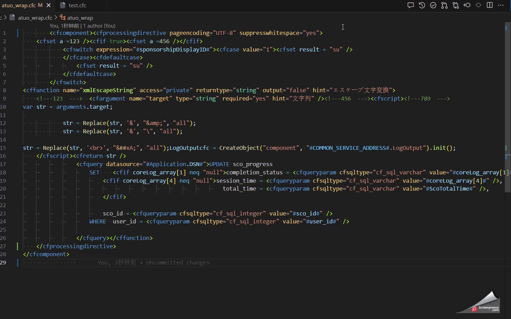
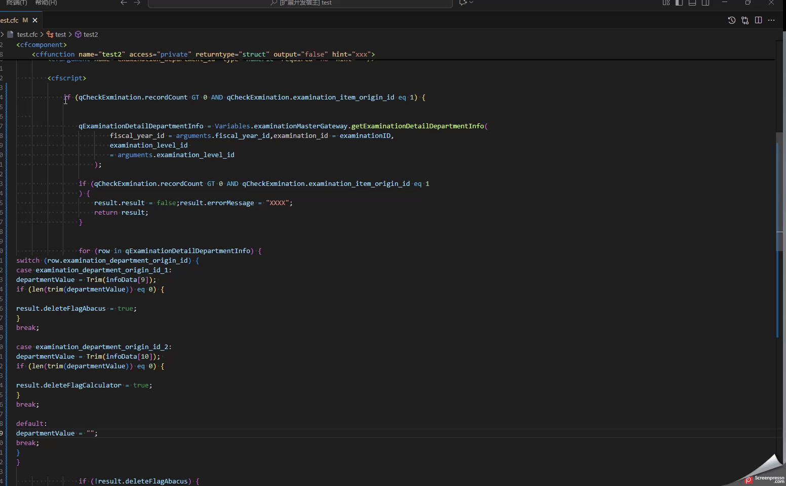

# 🐧🎈ᓚᘏᗢ    CFML Auto Formatter 

## 🏈 English

**CFML Code Auto-Formatting Extension** for VS Code.
This extension is **specialized in automatic tag wrapping** and **indent formatting**, without making unnecessary code style changes.

---

### Features

* **CFML (.cfc)** automatic indent formatting (stable operation)
* Automatic tag wrapping
* Partial formatting by block tags
* Preserves original code style
* Supports manual execution & automatic formatting on save
* Since it's implemented with JS and TS, you don't need to set up any Lucce or ColdFusion environment.
* It supports block content and allows selecting the content to be formatted, making it easier to manage the scope.
---

<h3>Usage</h3>
<ol>
  <li>Install the extension.</li>
  <li>Open a CFML file (<code>.cfm</code> or <code>.cfc</code>).</li>
  <li>Right-click and select <strong>Format Code (satt)</strong>.</li>
  <li>Choose from the available formatting options:
    <ul>
      <li><strong>CFTag Syntax</strong>: Formats CFML tags (e.g., <code>&lt;cfquery xxx&gt;XXX&lt;/cfquery&gt;</code>). If no content is selected, formats the entire CFC file.</li>
      <li><strong>Script Syntax</strong>: Formats content within <code>&lt;cfscript&gt;</code> blocks. Can also format embedded JavaScript.</li>
      <li><strong>SQL Syntax</strong>: Formats SQL content. </li>
      <li><strong>HTML Syntax</strong>: Formats HTML tag content within <code>.cfm</code> files.</li>
      <li><strong>CSS Syntax</strong>: Formats CSS content within <code>.cfm</code> files.</li>
    </ul>
  </li>
</ol>

---
### Notes

* `.cfc` file formatting operates stably
* `.cfm` files may have formatting issues → planned to improve in the future
* SQL statements should avoid <mark>leading commas</mark> <small>[why?](https://github.com/sql-formatter-org/sql-formatter/issues/899)</small>
* When formatting after focusing on the opening tag, the closing tag may be automatically added.
  This is an issue caused by another plugin (e.g. Auto Close Tag).
* SQL formatting is first done using **sql-formatter**.
  However, if it includes something particularly complex such as `cfloop`, my own custom logic is applied.
* The formatting of `cfscript` is very similar to JavaScript.
  If the string contains SQL statements, XML, or HTML tags, tags may break, so it’s better not to use it.
* Automatic tag wrapping is useful when a tag has many attributes, but short inline tags may also get wrapped.
* I have already tried using Lucee’s AST methods `astFromString()` and `astFromPath()`, but I couldn’t get detailed information from them. Below is the execution result I obtained, and I’m still experimenting with this.[See issue](https://github.com/satt-hri/vscode-plugin-cf-formatter/issues/20)

---

#### 1. Tag wrapping

  

#### 2. Partial formatting
| 2.1 CFTag Syntax                                                          | 2.2 Script Syntax                                                          |
| ------------------------------------------------------------------------- | -------------------------------------------------------------------------- |
|  |  |

#### 3. Indent formatting

  

---

### ⚙️ CFML Formatter Default Settings

| Setting                                                    | Default Value               | Type                   | Description                                                                           |
| ---------------------------------------------------------- | --------------------------- | ---------------------- | ------------------------------------------------------------------------------------- |
| <small>`hri.cfml.formatter.indentWithTabs`</small>         | <small>`true`</small>       | <small>boolean</small> | <small>Use tabs instead of spaces for indentation.</small>                            |
| <small>`hri.cfml.formatter.indentSize`</small>             | <small>`4`</small>          | <small>number</small>  | <small>Number of spaces when indenting with spaces (1–10).</small>                    |
| <small>`hri.cfml.formatter.indentChar`</small>             | <small>`" "`</small>        | <small>string</small>  | <small>Indent character: space `" "` or `\t`. Overridden by `indentWithTabs`.</small> |
| <small>`hri.cfml.formatter.wrapLineLength`</small>         | <small>`0`</small>          | <small>number</small>  | <small>Wrap lines after this many characters. `0` means no limit.</small>             |
| <small>`hri.cfml.formatter.maxPreserveNewlines`</small>    | <small>`2`</small>          | <small>number</small>  | <small>Maximum number of consecutive newlines to preserve (0–10).</small>             |
| <small>`hri.cfml.formatter.preserveNewlines`</small>       | <small>`true`</small>       | <small>boolean</small> | <small>Whether to preserve existing newlines.</small>                                 |
| <small>`hri.cfml.formatter.keepArrayIndentation`</small>   | <small>`false`</small>      | <small>boolean</small> | <small>Whether to preserve original array indentation.</small>                        |
| <small>`hri.cfml.formatter.braceStyle`</small>             | <small>`"collapse"`</small> | <small>string</small>  | <small>Brace style: `collapse` / `expand` / `end-expand` / `none`.</small>            |
| <small>`hri.cfml.formatter.breakChainedMethods`</small>    | <small>`false`</small>      | <small>boolean</small> | <small>Whether to break chained methods into multiple lines.</small>                  |
| <small>`hri.cfml.formatter.spaceBeforeConditional`</small> | <small>`true`</small>       | <small>boolean</small> | <small>Whether to add a space before conditionals (if, while, for).</small>           |
| <small>`hri.cfml.formatter.endWithNewline`</small>         | <small>`false`</small>      | <small>boolean</small> | <small>Whether to add a newline at the end of the file.</small>                       |
| <small>`hri.cfml.formatter.expressionWidth`</small>        | <small>`30`</small>         | <small>number</small>  | <small>Wrap lines when the SQL string length exceeds this value.</small>              |
| <small>`hri.cfml.formatter.sqlLanguage`</small>            | <small>`"mysql"`</small>    | <small>string</small>  | <small>Select SQL dialect for formatting.</small>                                     |

💡 **How to Change Settings**
Press **`Ctrl + ,`** in VSCode and enter **"Format Code (satt)"** in the search box to make changes.
After modifying, don’t forget to reload the window!

---

## 👘 日本語

VS Code 用 **CFML コード自動整形拡張機能**。  
この拡張機能は **タグの自動改行**、**インデント整形に特化** しており、余計なコードスタイルの変更は行いません。

---

### 機能
- **CFML (.cfc)** コードの自動インデント整形（安定動作）
- タグの自動改行
- ブロックタグごとで部分的にフォーマット
- 元のコードスタイルを保持
- 手動実行 & 保存時自動整形に対応
- JSとTSで実装されているため、LucceやColdFusion環境を構築する必要はありません。
- ブロック単位での内容に対応し、整形対象を選択できるため、範囲を管理しやすくなります。

---

<h3>使い方</h3>
<ol>
  <li>拡張機能をインストール</li>
  <li>CFML ファイルを開く（<code>.cfm</code> または <code>.cfc</code>）</li>
  <li>ショートカット <strong>Shift + Alt + M</strong> または右クリックで <strong>Format Code (satt)</strong> を選択</li>
  <li>利用可能なフォーマットオプションから選択:
    <ul>
      <li><strong>CFTag 構文</strong>: CFML タグをフォーマットします（例: <code>&lt;cfquery xxx&gt;XXX&lt;/cfquery&gt;</code>）。選択がない場合は CFC ファイル全体をフォーマットします。</li>
      <li><strong>Script 構文</strong>: <code>&lt;cfscript&gt;</code> ブロック内のコンテンツをフォーマットします。埋め込まれた JavaScript もフォーマット可能です。</li>
      <li><strong>SQL 構文</strong>: Formats SQL content 。</li>
      <li><strong>HTML 構文</strong>: <code>.cfm</code> ファイル内の HTML タグコンテンツをフォーマットします。</li>
      <li><strong>CSS 構文</strong>: <code>.cfm</code> ファイル内の CSS コンテンツをフォーマットします。</li>
    </ul>
  </li>
</ol>

---

### 注意点
- `.cfc` ファイルの整形は安定動作  
- `.cfm` ファイルは整形が乱れる場合あり → 今後改善予定  
- SQL文は<mark>カンマ前置をしないように</mark> <small>[何故?](https://github.com/sql-formatter-org/sql-formatter/issues/899)
- 開始タグにフォーカスしてからフォーマットすると、自動で閉じタグが追加されてしまう場合がある。これは他のプラグインの問題である。例: (Auto Close Tag)
- SQL のフォーマットは、まず **sql-formatter** を使用します。ただし、`cfloop` など特に複雑なものを含む場合は、自作のロジックでフォーマットします。  
- `cfscript` のフォーマットは、JavaScript と非常に似ています。
   SQL 文や XML、HTML タグが含まれていると、タグが壊れることがあるので、使わないほうがいいです。
- タグの自動改行は属性が多い場合に便利ですが、インラインで短いタグを使いたいケースでは改行されることがあります。

---

### CFML フォーマッタ デフォルト設定

| 設定項目                                                   | デフォルト値                | 型                     | 説明                                                                                         |
| ---------------------------------------------------------- | --------------------------- | ---------------------- | -------------------------------------------------------------------------------------------- |
| <small>`hri.cfml.formatter.indentWithTabs`</small>         | <small>`true`</small>       | <small>boolean</small> | <small>インデントにスペースではなくタブを使用する。</small>                                  |
| <small>`hri.cfml.formatter.indentSize`</small>             | <small>`4`</small>          | <small>number</small>  | <small>スペースでインデントする場合のスペース数（1–10）。</small>                            |
| <small>`hri.cfml.formatter.indentChar`</small>             | <small>`" "`</small>        | <small>string</small>  | <small>インデント文字：スペース `" "` または `\t`。`indentWithTabs` で上書きされる。</small> |
| <small>`hri.cfml.formatter.wrapLineLength`</small>         | <small>`0`</small>          | <small>number</small>  | <small>この文字数を超えると改行。`0` は制限なし。</small>                                    |
| <small>`hri.cfml.formatter.maxPreserveNewlines`</small>    | <small>`2`</small>          | <small>number</small>  | <small>連続して保持する改行の最大数（0–10）。</small>                                        |
| <small>`hri.cfml.formatter.preserveNewlines`</small>       | <small>`true`</small>       | <small>boolean</small> | <small>既存の改行を保持するかどうか。</small>                                                |
| <small>`hri.cfml.formatter.keepArrayIndentation`</small>   | <small>`false`</small>      | <small>boolean</small> | <small>配列の元のインデントを保持するかどうか。</small>                                      |
| <small>`hri.cfml.formatter.braceStyle`</small>             | <small>`"collapse"`</small> | <small>string</small>  | <small>波括弧スタイル：`collapse` / `expand` / `end-expand` / `none`。</small>               |
| <small>`hri.cfml.formatter.breakChainedMethods`</small>    | <small>`false`</small>      | <small>boolean</small> | <small>メソッドチェーンを複数行に分割するかどうか。</small>                                  |
| <small>`hri.cfml.formatter.spaceBeforeConditional`</small> | <small>`true`</small>       | <small>boolean</small> | <small>条件文（if, while, for）の前にスペースを入れるか。</small>                            |
| <small>`hri.cfml.formatter.endWithNewline`</small>         | <small>`false`</small>      | <small>boolean</small> | <small>ファイル末尾に改行を追加するかどうか。</small>                                        |
| <small>`hri.cfml.formatter.expressionWidth`</small>        | <small>`30`</small>         | <small>number</small>  | <small>sql指定文字列長さを超えると改行</small>                                               |
| <small>`hri.cfml.formatter.sqlLanguage`</small>            | <small>`"mysql"`</small>    | <small>string</small>  | <small>フォーマットSQLを選ぶ</small>                                                         |

💡 **設定変更方法**  
VSCode で **`Ctrl + ,`** を押し、検索欄に **「Format Code (satt)」** と入力すると変更可能。変更があったら、再起動みたいな操作でウィンドウをリロードするのを忘れないでね  

